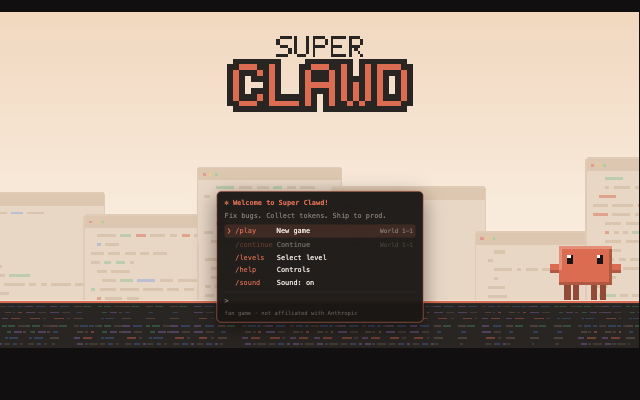
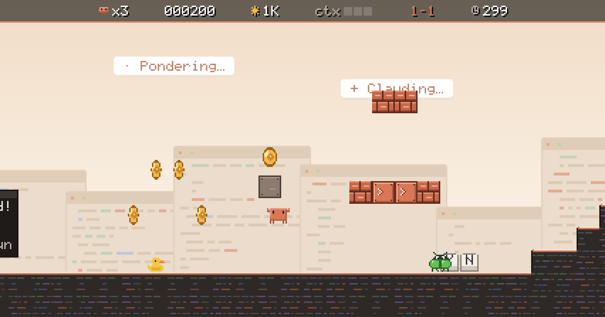
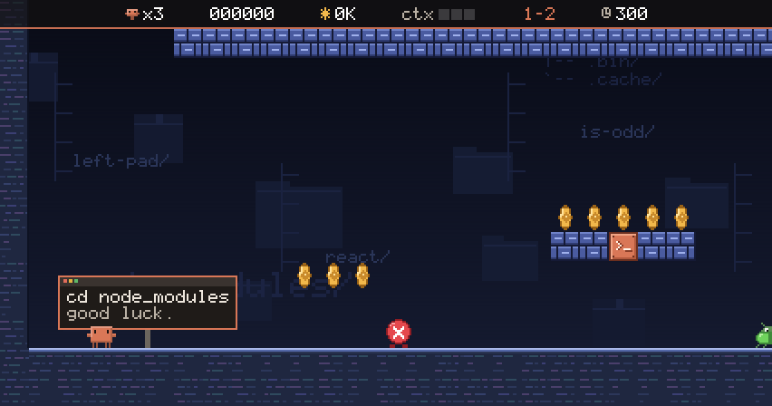
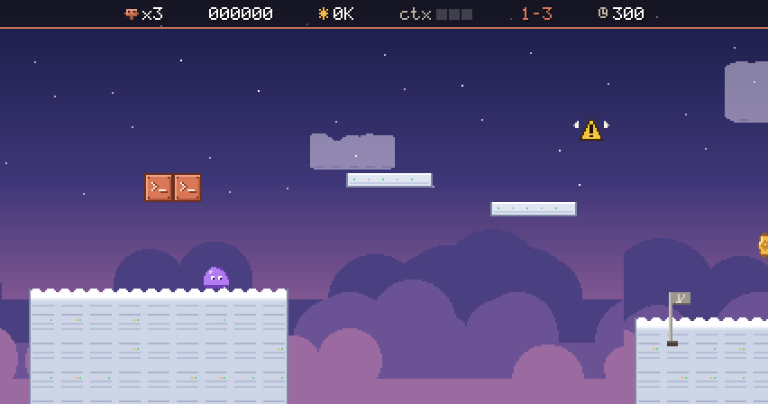
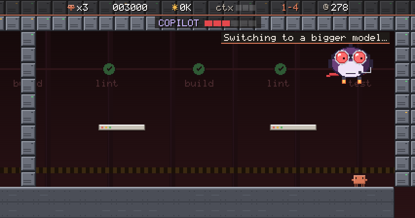
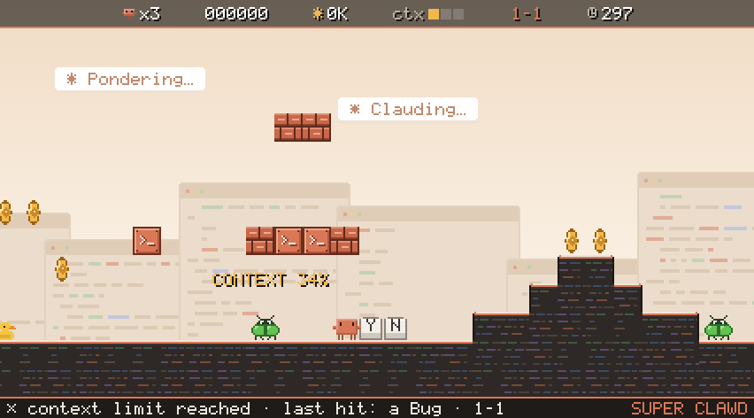

# Super Clawd

A retro platformer starring **Clawd**, the Claude Code mascot. Fix bugs, collect tokens, survive the permission prompts, ship to prod, and beat Copilot.



> Fan game. Not affiliated with or endorsed by Anthropic. "Claude", "Claude Code" and Clawd belong to Anthropic; rival bosses are cartoon parodies.

## Features

- **World 1: Terminal**: four levels plus a boss fight against Copilot
- **Every joke is an engineering joke**: Bugs, Infinite Loops, Flaky Tests, Null Pointers, Memory Leaks, node_modules, a red CI pipeline
- **Claude Code power-ups**: Opus, Subagents, Bypass Permissions, `/compact`, ultrathink
- **Permission prompts** that look like the real thing, including an `rm -rf ~/` you really should not approve
- **Death replays**: share a GIF of your last three seconds with one tap
- Original chiptune soundtrack, all pixel art drawn in code, no game framework
- Plays with keyboard, gamepad or touch, on desktop and phones, and installs as a home-screen app

|                                        |                                                |
| -------------------------------------- | ---------------------------------------------- |
|  |          |
|  |  |

## Play

```bash
npm install
npm run dev
```

Open http://localhost:5180. The dev server also listens on your local network, so you can play on a phone on the same Wi-Fi.

### Controls

|                       | Keyboard          | Touch | Gamepad       |
| --------------------- | ----------------- | ----- | ------------- |
| Move                  | ← → / A D         | ◀ ▶   | D-pad / stick |
| Jump                  | ↑ / Space / Z / W | A     | A             |
| Run + throw subagents | Shift / X         | B     | B / X         |
| Crouch, enter pipes   | ↓ / S             | ▼     | D-pad down    |
| Pause                 | Esc / P / Enter   | ❚❚    | Start         |
| Mute                  | M                 |       |               |

## How it plays

| Concept           | In Super Clawd                                                         |
| ----------------- | ---------------------------------------------------------------------- |
| Coins             | **Tokens**. 100K tokens = extra life                                   |
| Health            | **Context window**. Each hit as Sonnet fills a third; full = game over |
| Mushroom          | **Opus**: bigger, breaks blocks, survives a hit                        |
| Fire flower       | **Subagents**: throw bouncing mini Clawds                              |
| Star              | **Bypass Permissions**: ten seconds of invincibility                   |
| Checkpoint        | **git commit**                                                         |
| Flagpole / castle | **✓ All tests passed**, then walk into **PROD**                        |

| Level                | What's new                                                                            |
| -------------------- | ------------------------------------------------------------------------------------- |
| 1-1 Hello, World     | Bugs, prompt blocks, Opus, Infinite Loop shells, `npm test` prompt, secret `~/.cache` |
| 1-2 node_modules     | Flaky Tests, a 429 rate-limit wall, lifts, a shell-kicking corridor                   |
| 1-3 The Cloud        | Moving and crumbling platforms, Deprecated Warnings, Memory Leaks, Null Pointers      |
| 1-4 Copilot's Hangar | Red CI lava, node_modules crushers, spinner bars, then Copilot                        |



## Development

```bash
npm test           # unit, mechanics, solver, route-bot and fuzz tests
npm run typecheck
npm run build      # production build into dist/
npm run format     # Prettier
```

URL flags for testing: `?level=1-3` jump to a level · `&x=80` start at tile 80 · `&skipintro` · `?mute=1` disable audio entirely · `?touch` force touch controls · `?debug` show position.

`window.__superclawd.step(frames, ['right', 'jump'])` advances the simulation with scripted input, which is handy for browser automation.

### Project layout

| Path                        | What lives there                                                       |
| --------------------------- | ---------------------------------------------------------------------- |
| `src/engine`                | Input (keyboard, touch, gamepad), pixel font, sprite and color helpers |
| `src/game`                  | Physics, player, level builder, world rules, HUD, scenes               |
| `src/game/entities`         | Enemies, items, platforms, gates and the Copilot boss                  |
| `src/game/levels/world1.ts` | The four levels, written with a small builder API                      |
| `src/art`                   | All pixel art, drawn procedurally                                      |
| `src/audio`                 | WebAudio chiptune synth and soundtrack                                 |
| `src/share`                 | Replay recorder, GIF encoder (Web Worker), share sheet                 |
| `tests`                     | Vitest suites, including a level solver and a timing-aware route bot   |

Game rules never touch the DOM, so the whole simulation runs headless in tests. See [docs/DESIGN.md](docs/DESIGN.md) for the design notes and roadmap.

## License

[MIT](LICENSE) for the code. Characters and names from Claude Code belong to Anthropic.
